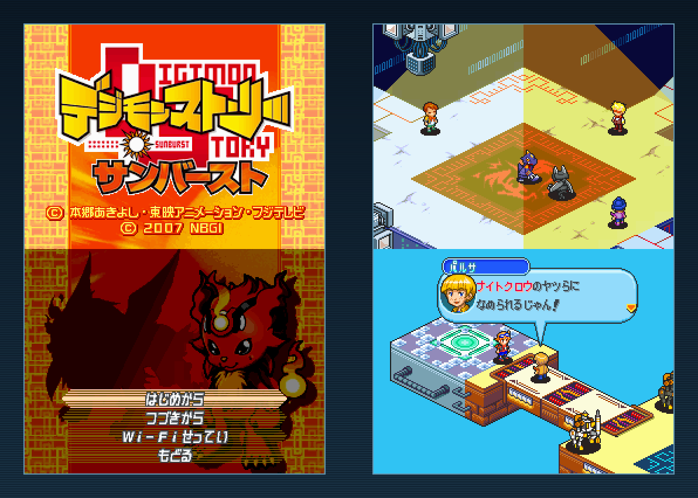
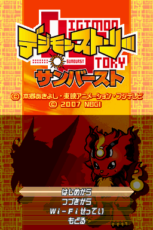
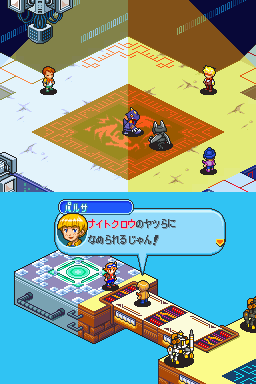

# Digimon Story: Sunburst — native Windows recompilation

A static recompilation of **Digimon Story: Sunburst (Japan) (Rev 1)** for 64-bit
Windows. The DS ARM9 and ARM7 programs are translated to C at build time and
compiled into a native executable: this is **not an emulator**, and it ships
with no game data.

You bring your own cartridge dump. The first launch checks it, builds the
runtime on your machine, and starts the game.

[English](README.md) · [简体中文](README.zh-CN.md) · [Building](docs/BUILDING.md) ·
[How it works](docs/HOW_IT_WORKS.md) · [Mods](sunburst-recomp/docs/MODS.md)



> **Unofficial fan project.** Not affiliated with or endorsed by Bandai Namco,
> Nintendo, or the Digimon rights holders. No ROM, BIOS dump, firmware image,
> save file, or recompiled game code is distributed here. Digimon Story and its
> assets belong to their respective owners.

---

## Play on Windows

1. Download `sunburst-<version>-windows-x64-sources.zip` from
   [Releases](https://github.com/aoxzh/digimon-story-sunburst-recomp/releases) and unzip it somewhere writable — for example
   `Documents\Sunburst`, **not** `Program Files`.
2. Put your own dump at
   `rom\Digimon Story - Sunburst (Japan) (Rev 1).nds`.
3. Run **`play.bat`**.

The first run downloads a pinned private toolchain (LLVM-MinGW, CMake, Ninja,
SDL3, ndspy), verifies it, compiles the recompiler and the runtime, then starts
the game. Expect **2–5 minutes** on a modern machine and roughly 1 GB of disk
for the toolchain. Later launches start immediately.

This repository and its release publish the sources shape only — there is no
prebuilt executable. The runner is compiled on your machine, so the download
stays small and no translated game code is redistributed.

### What you need

| Requirement | Notes |
|---|---|
| Windows 10/11 x64 | The build kit targets llvm-mingw; no Visual Studio needed |
| Your own ROM | Japan, Rev 1, 64 MiB, exact dump listed below |
| ~1 GB free disk | Toolchain plus build output |
| Internet on first run | Only for the toolchain; the game itself never phones home |
| No BIOS dump | The port builds FreeBIOS banks; retail BIOS is optional |

### ROM

| | |
|---|---|
| Title | Digimon Story: Sunburst (Japan) (Rev 1) |
| Game code | `A3VJ` |
| Size | 67,108,864 bytes (64 MiB) |
| SHA-1 | `2fa1c272974fdef6b8f2acc3f9f778dd4111a587` |
| SHA-256 | `a92788836ddf4fbe00e3f9db7a14ea1f5dc3361cdc4cec088a19a8634838e0fb` |

Other regions and revisions are not supported: the ROM hash is compiled into
the executable and a different image is refused at startup. A translation patch
is only supported through the build-time mod pipeline, never by renaming a
patched file to look like the retail dump.

---

## Screenshots

| Title | Field |
|---|---|
|  |  |

Both are 256×384 captures from the port itself, straight from the DS
framebuffers, not from an emulator.

---

## Controls

| DS | Keyboard |
|---|---|
| D-pad | Arrow keys |
| A | `X` |
| B | `Z` |
| X | `S` |
| Y | `A` |
| L / R | `C` / `V` |
| Start | `Enter` |
| Select | `Right Shift` |
| Touch screen | Mouse (left click) |

| Feature | Key |
|---|---|
| Settings menu | `Esc` (arrows navigate, `Enter` selects, `Backspace` goes back) |
| Fast forward (held) | `Left Shift` |
| Save state slot 1–12 | `F1`–`F12` |
| Save state (write) | `Shift` + `F1`–`F12` |
| Save state (load) | `F1`–`F12` |

Gamepads are detected automatically. Settings live in `settings.ini`; saves in
`saves\`, save states in `savestates\`, logs in `logs\`.

---

## What works

| Area | Status |
|---|---|
| Boot → title → save select → field | Verified on this release build (900 frames) |
| Movement, dialogue, menus, touch | Verified on the first chapter route |
| Battery save (64 KiB EEPROM) | Verified (write, reload, power-cycle restore) |
| Save states, 12 slots | Verified |
| Settings menu, volume, settings persistence | Verified |
| Display filters (colour curve, LCD grid), integer scaling | Verified |
| Fast forward (2×–4×) | Verified |
| FreeBIOS boot without retail BIOS dumps | Verified on this release build |
| Later chapters and the full game | **Not verified** |
| Wi-Fi / local wireless, microphone, IR | Not implemented |
| 3D-heavy scenes | 3D renderer present, not exercised by the tested route |

The feature checks were run on the development build of this port. The release
archive is the base-bank build: it boots and renders the same route (the
900-frame frame digest matches), but promotes fewer code regions, so expect more
interpreter work in long scripted stretches. Behaviour differences are not
expected from that difference alone.

The tested route is the opening of the Japanese release: roughly the first
chapter, ending after several map loads and dialogue scenes. Treat everything
past that as unproven rather than working.

Save files are raw 64 KiB EEPROM images. Compatibility with saves written by
other emulators has not been verified; keep a backup.

---

## Performance

On the development machine the tested route runs at roughly **2× real time**
with audio as the clock; the title screen benchmarks far above real time. Full
scene rendering, audio mixing and the guest CPUs all run natively, and the
interpreter is only used for bytes that fail the runtime validation guard (see
below), so heavy scenes cost more than menus but do not fall off a cliff.

Numbers are host-dependent and not a promised frame rate. The build produced by
the release zip is the base-bank build; the development build additionally
promotes reviewed code regions, which mainly helps long interpreted stretches.

---

## How it works

1. `prepare` verifies the ROM and extracts the ARM9 image, the ARM7 image and
   every overlay into a build directory.
2. The recompiler walks the ARM9/ARM7 entry points and emits C for each
   function, with a validation record (address, length, source bytes) beside it.
3. The banks are compiled and linked with the runtime: memory map, 2D engines,
   melonDS-derived 3D rasteriser, audio mixer, DMA, timers, IPC, EEPROM and an
   SDL3 front end.
4. Before a translated function runs, the runtime checks that the guest bytes
   still match the bytes it was compiled from. If a region was overwritten at
   run time (self-modifying code, a loader-produced block), it falls back to the
   bounded Tier-3 interpreter instead of executing a stale translation.

There is no HLE shortcut for game behaviour: the game's own code runs, either
native or interpreted. Details and the build pipeline are in
[docs/HOW_IT_WORKS.md](docs/HOW_IT_WORKS.md).

---

## Building

The short version, from a checkout with a working C toolchain:

```bat
cd sunburst-recomp
python -m pip install ndspy
python tools\sunburst.py prepare
python tools\sunburst.py recompiler
python tools\sunburst.py banks
python tools\sunburst.py build
```

The runner lands in `sunburst-recomp\generated\windows\runner\`. For the
first-start kit (no compiler installed), use the release zip and `play.bat`.
Full prerequisites, toolchain discovery and troubleshooting are in
[docs/BUILDING.md](docs/BUILDING.md).

---

## FAQ

**Is this an emulator?** No. The ARM9/ARM7 code is translated to C at build
time and compiled to x64. There is no instruction-by-instruction emulation of
the game's code, and no cartridge bus timing to get wrong.

**Do I need BIOS dumps?** No. The port builds FreeBIOS banks and generated
firmware. Retail BIOS dumps are optional and only used by the `--boot lle`
development mode.

**Can I share the built `nds_runner.exe`?** The executable links GPL-3.0-or-later
components from the vendored framework, so it is a GPL combined work. Share it
under those terms, and never with the ROM, BIOS, firmware, saves or generated
game code bundled in.

**Why is the executable so large?** It contains compiled game code plus the
runtime and its assets. A debug build of the promoted bank can be a few hundred
megabytes; the release build from the zip is much smaller because it compiles
only the base banks.

**Why does the first start download a compiler?** Shipping a compiler and SDK
would multiply the download and drag in licences that do not belong in a fan
project. The kit is fetched once, SHA-256 verified, and reused.

**It says my ROM is wrong.** Check the SHA-1 above. A patched, trimmed, or
different-region image is refused by design.

**Where are my saves?** `saves\sunburst.sav` beside `play.bat`; save states in
`savestates\slot-01.state` … `slot-12.state`.

**Does it work on Linux or macOS?** Not yet. The tools are portable and the
framework builds on other hosts, but this release ships a Windows build kit only.

**Can I use a translation patch?** Yes, through the build-time mod pipeline:
drop an IPS/IPS32/BPS patch into `sunburst-recomp\mods\translation\` and build
from source. See [docs/MODS.md](sunburst-recomp/docs/MODS.md).

---

## Sister port: Digimon World: Dusk

*Digimon World: Dusk* (USA) is the North American release of this engine: the
ARM7 program is byte-identical and the ARM9 nearly so.
[digimon-world-dusk-recomp](https://github.com/aoxzh/digimon-world-dusk-recomp)
shares this repository's framework, build driver, release kit and fixes; the
two differ only in title identity, configuration and documentation.

---

## License

The original tooling, build scripts, configuration and documentation in this
repository are MIT licensed; see [LICENSE](LICENSE). The game is not covered and
is not distributed. The vendored framework keeps its own licences: ndsrecomp is
PolyForm Noncommercial 1.0.0 with MIT and GPL-3.0-or-later portions, recomp-ui is
MIT, FreeBIOS is BSD-2-Clause, and the melonDS-derived GPU code is
GPL-3.0-or-later. See [THIRD_PARTY_NOTICES.md](THIRD_PARTY_NOTICES.md) and the
licence files under `framework/`.

## Credits

- [ndsrecomp](https://github.com/mstan/ndsrecomp) and
  [recomp-ui](https://github.com/mstan/recomp-ui) by Matthew Stanley — the
  static recompiler, runtime and UI framework.
- [melonDS](https://melonds.kuribo64.net/) — GPL-3.0 3D rasteriser lineage.
- [FreeBIOS](https://github.com/pspdev/freebios) — BSD-2-Clause BIOS
  replacement used for the free boot path.
- [ndspy](https://github.com/RoadrunnerWMC/ndspy) — NDS image parsing.
- [SDL3](https://www.libsdl.org/), [LLVM-MinGW](https://github.com/mstorsjo/llvm-mingw),
  [CMake](https://cmake.org/), [Ninja](https://ninja-build.org/) — build kit.
- [GBATEK](https://problemkaputt.de/gbatek.htm) — hardware reference.
- The Digimon Story decompilation and research community.

Development of this port used AI assistance (Claude); every change was built,
run and gated against the captured reference behaviour before it was kept.
