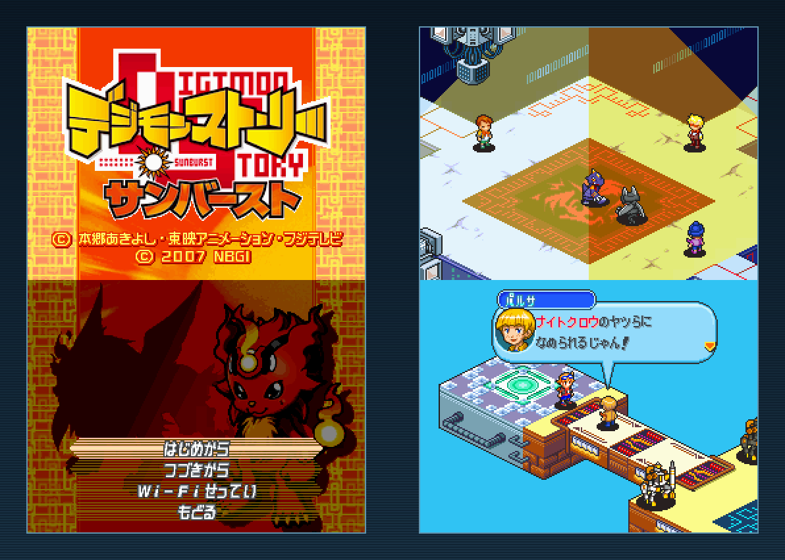
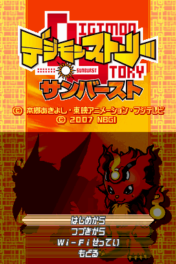
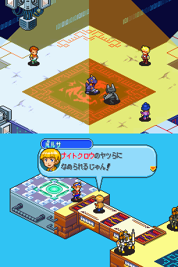

# 数码宝贝故事：日光 — Windows 原生重编译版

把 **《数码宝贝故事：日光》（日版 Rev 1）** 的 NDS ARM9 / ARM7 程序在构建时
翻译成 C，再编译成 64 位 Windows 原生可执行文件。**这不是模拟器**，仓库里
不附带任何游戏数据。

你需要自备卡带转储。第一次启动会校验转储、在本机构建运行时，然后进入游戏。

[English](README.md) · [简体中文](README.zh-CN.md) · [构建](docs/BUILDING.md) ·
[工作原理](docs/HOW_IT_WORKS.md) · [Mods](sunburst-recomp/docs/MODS.md)



> **非官方同人项目。** 与万代南梦宫、任天堂及数码宝贝版权方无隶属或背书关系。
> 本仓库不分发 ROM、BIOS 转储、固件、存档或重编译生成物。游戏及素材版权归
> 各自权利人所有。

---

## Windows 上运行

1. 从 [Releases](https://github.com/aoxzh/digimon-story-sunburst-recomp/releases) 下载
   `sunburst-<版本>-windows-x64-sources.zip`，解压到可写目录
   （例如 `文档\Sunburst`，**不要**放进 `Program Files`）。
2. 把你自己的转储放到
   `rom\Digimon Story - Sunburst (Japan) (Rev 1).nds`。
3. 双击 **`play.bat`**。

首次启动会下载一套私有工具链（LLVM-MinGW、CMake、Ninja、SDL3、ndspy），
校验后编译重编译器与运行时，然后启动游戏。现代机器约需 **2–5 分钟**，
工具链占约 1 GB 磁盘。以后启动是即时的。

本仓库和 Release 只提供源码形态，不提供预编译可执行文件。运行时在你的机器上
编译，因此下载体积小，也不分发翻译后的游戏代码。

### 需要什么

| 项目 | 说明 |
|---|---|
| Windows 10/11 x64 | 构建套件使用 llvm-mingw，不需要 Visual Studio |
| 自己的 ROM | 日版 Rev 1，64 MiB，必须是下表所列精确转储 |
| 约 1 GB 磁盘 | 工具链和构建产物 |
| 首次联网 | 只用于下载工具链；游戏本身不联网 |
| 不需要 BIOS 转储 | 使用 FreeBIOS 构建；零售 BIOS 可选 |

### ROM

| | |
|---|---|
| 名称 | Digimon Story: Sunburst (Japan) (Rev 1) |
| 游戏编号 | `A3VJ` |
| 大小 | 67,108,864 字节（64 MiB） |
| SHA-1 | `2fa1c272974fdef6b8f2acc3f9f778dd4111a587` |
| SHA-256 | `a92788836ddf4fbe00e3f9db7a14ea1f5dc3361cdc4cec088a19a8634838e0fb` |

其他区域和修订版不支持：ROM 哈希会编进可执行文件，启动时拒绝不匹配的镜像。
翻译补丁只能走构建期 mod 流程，不能把改过的文件改名冒充零售转储。

---

## 截图

| 标题画面 | 场景与对话 |
|---|---|
|  |  |

两张都是端口直接抓取的 256×384 画面，来自 DS 帧缓冲，不是模拟器截图。

---

## 操作

| DS | 键盘 |
|---|---|
| 十字键 | 方向键 |
| A | `X` |
| B | `Z` |
| X | `S` |
| Y | `A` |
| L / R | `C` / `V` |
| Start | `Enter` |
| Select | `Right Shift` |
| 触摸屏 | 鼠标左键 |

| 功能 | 按键 |
|---|---|
| 设置菜单 | `Esc`（方向键移动，`Enter` 选择，`Backspace` 返回） |
| 快进（按住） | `Left Shift` |
| 即时存档槽 1–12 | `F1`–`F12` |
| 存档（写入） | `Shift` + `F1`–`F12` |
| 读档 | `F1`–`F12` |

自动识别手柄。设置保存在 `settings.ini`，电池存档在 `saves\`，即时存档在
`savestates\`，日志在 `logs\`。

---

## 目前可玩到哪

| 项目 | 状态 |
|---|---|
| 启动 → 标题 → 读档界面 → 场景 | 已在本发布构建上验证（900 帧） |
| 移动、对话、菜单、触摸 | 在第一章路线验证 |
| 电池存档（64 KiB EEPROM） | 已验证（写入、重读、断电恢复） |
| 即时存档，12 个槽 | 已验证 |
| 设置菜单、音量、设置持久化 | 已验证 |
| 显示滤镜（色彩曲线、LCD 网格）、整数缩放 | 已验证 |
| 快进（2×–4×） | 已验证 |
| 无零售 BIOS、FreeBIOS 启动 | 已在本发布构建上验证 |
| 后续章节与完整流程 | **未验证** |
| Wi-Fi / 本地联机、麦克风、红外 | 未实现 |
| 3D 重的场景 | 有 3D 渲染器，但测试路线未覆盖 |

功能检查是在本移植的开发构建上做的。本发布包是 base-bank 构建：它启动并渲染
同一条路线（900 帧画面哈希一致），但预编译的代码区域更少，长时间脚本段里解释器
的工作会更多。仅凭这一差异不应出现行为变化。

测试路线是日版开头约第一章，包含多次地图切换和对话。之后的流程请当作
未验证，而不是“能用”。

存档是原始 64 KiB EEPROM 镜像。与其他模拟器存档的兼容性未验证，请先备份。

---

## 性能

开发机上测试路线约 **2 倍实时**（以音频为时钟）；标题画面基准远高于实时。
场景渲染、音频混音和两个 CPU 都原生运行，解释器只用于运行时校验失败的区域
（见下文），所以重场景比菜单更贵，但不会突然掉到不可玩。

数字取决于机器，不是承诺帧率。发布 zip 构建的是基础 bank；开发构建额外
提升（promote）了部分代码区域，主要改善长段解释执行。

---

## 工作原理

1. `prepare` 校验 ROM，抽取 ARM9 镜像、ARM7 镜像和全部 overlay。
2. 重编译器从入口点遍历，把每个函数生成 C，并在旁边写校验记录
   （地址、长度、源字节）。
3. 这些 bank 与运行时一起编译链接：内存映射、2D 引擎、melonDS 系 3D 光栅化、
   音频混音、DMA、定时器、IPC、EEPROM 和 SDL3 前端。
4. 原生函数执行前，运行时检查客户机字节是否仍与编译时一致。若该区域在运行中
   被改写（自修改代码、加载器生成的块），则回退到有界 Tier-3 解释器，
   而不是执行过期的翻译。

游戏行为没有 HLE 捷径：游戏自己的代码在跑，要么原生，要么解释。细节见
[docs/HOW_IT_WORKS.md](docs/HOW_IT_WORKS.md)。

---

## 从源码构建

已有 C 工具链时，最简流程：

```bat
cd sunburst-recomp
python -m pip install ndspy
python tools\sunburst.py prepare
python tools\sunburst.py recompiler
python tools\sunburst.py banks
python tools\sunburst.py build
```

运行时会生成到 `sunburst-recomp\generated\windows\runner\`。没有编译器的机器
请用发布 zip 和 `play.bat`。完整前置条件、工具链发现和排错见
[docs/BUILDING.md](docs/BUILDING.md)。

---

## 常见问题

**这是模拟器吗？** 不是。ARM9/ARM7 代码在构建时翻译成 C 再编译成 x64，
不存在逐条模拟游戏代码，也没有卡带总线时序问题。

**需要 BIOS 转储吗？** 不需要。端口构建 FreeBIOS bank 和生成固件；零售 BIOS
只在 `--boot lle` 开发模式下可选。

**能分享编译出的 `nds_runner.exe` 吗？** 可执行文件链接了框架中
GPL-3.0-or-later 的组件，属于 GPL 组合作品，请按相应条款分享，且绝不要
连同 ROM、BIOS、固件、存档或生成代码一起打包。

**为什么可执行文件这么大？** 里面有编译后的游戏代码、运行时和资源。开发版
的 promoted bank 调试构建可达数百 MB；发布 zip 只编译基础 bank，体积小得多。

**为什么第一次启动要下载编译器？** 直接附带编译器和 SDK 会让下载体积翻几倍，
也会把不属于同人项目的许可证拖进来。套件只下载一次，经 SHA-256 校验后复用。

**提示 ROM 不对。** 对照上面的 SHA-1。打过补丁、裁剪过或不同区域的镜像会被
设计性地拒绝。

**存档在哪？** `play.bat` 旁的 `saves\sunburst.sav`；即时存档在
`savestates\slot-01.state` … `slot-12.state`。

**支持 Linux / macOS 吗？** 暂不支持。工具本身是可移植的，框架也能在其他宿主
构建，但这个版本只提供 Windows 构建套件。

**能用翻译补丁吗？** 可以，走构建期 mod 流程：把 IPS/IPS32/BPS 补丁放进
`sunburst-recomp\mods\translation\`，再从源码构建。见
[docs/MODS.md](sunburst-recomp/docs/MODS.md)。

---

## 姊妹端口：Digimon World: Dusk

《Digimon World: Dusk》（美版）是本引擎的北美版本：ARM7 程序逐字节相同，ARM9 几乎相同。
[digimon-world-dusk-recomp](https://github.com/aoxzh/digimon-world-dusk-recomp)
与本仓库共用框架、构建驱动、发布套件和修复；两者只在游戏标识、配置和文档上不同。

---

## 许可证

本仓库原创的工具、构建脚本、配置和文档采用 MIT 许可证，见 [LICENSE](LICENSE)。
游戏不在许可范围内，也不随仓库分发。内嵌框架保留各自许可证：ndsrecomp 为
PolyForm Noncommercial 1.0.0（含 MIT 与 GPL-3.0-or-later 部分），recomp-ui 为
MIT，FreeBIOS 为 BSD-2-Clause，melonDS 系 GPU 代码为 GPL-3.0-or-later。
详见 [THIRD_PARTY_NOTICES.md](THIRD_PARTY_NOTICES.md) 与 `framework/` 下的
许可证文件。

## 致谢

- [ndsrecomp](https://github.com/mstan/ndsrecomp) 与
  [recomp-ui](https://github.com/mstan/recomp-ui)（Matthew Stanley）——
  静态重编译器、运行时和 UI 框架。
- [melonDS](https://melonds.kuribo64.net/)——GPL-3.0 3D 光栅化代码来源。
- [FreeBIOS](https://github.com/pspdev/freebios)——BSD-2-Clause 的自由启动
  BIOS 替代。
- [ndspy](https://github.com/RoadrunnerWMC/ndspy)——NDS 镜像解析。
- [SDL3](https://www.libsdl.org/)、[LLVM-MinGW](https://github.com/mstorsjo/llvm-mingw)、
  [CMake](https://cmake.org/)、[Ninja](https://ninja-build.org/)——构建套件。
- [GBATEK](https://problemkaputt.de/gbatek.htm)——硬件参考。
- 数码宝贝故事反编译与研究社区。

本端口的开发使用了 AI 辅助（Claude）；每一处改动都经过构建、运行，并与抓取的
参考行为比对通过后才保留。
